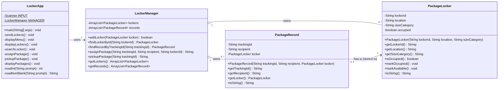

# HW02: Campus Package Locker Tracker

Console app that models campus package lockers as objects. You can assign packages to lockers, pick them up, and see which lockers are free.

## Run

```
cd hw02
javac -d out src/*.java
java -cp out LockerApp
```

## Classes

| Class | Responsibility |
|---|---|
| `PackageLocker` | One locker: ID, location, size, and occupied state. Changes its own state with `markOccupied()` / `markAvailable()`. |
| `PackageRecord` | One active package: tracking ID and recipient. HAS-A `PackageLocker` reference instead of copying locker fields. |
| `LockerManager` | Owns both ArrayLists. Searches, plus the assign/pickup rules (no duplicate tracking IDs, no missing or occupied lockers). Validates first, changes state last. |
| `LockerApp` | Console menu. Input, delegate to the manager, output. Re-prompts on bad menu input or blank text. |

## UML



Source: [docs/HW02-UML.mmd](docs/HW02-UML.mmd)

## Testing

Filled-in evidence sheet: [docs/COMP240-HW02-TEST-EVIDENCE.docx](docs/COMP240-HW02-TEST-EVIDENCE.docx). Raw output for T1–T6 and the defect/retest is in `tests/`. The required `README.txt` with one short description per class is also in this folder.
