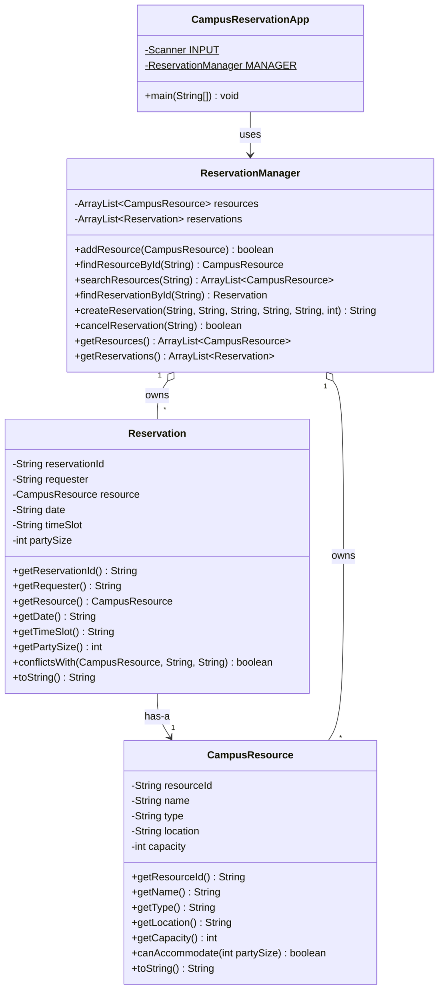

# COMP 240 Project 1: Campus Resource Reservation System

Console app for reserving campus resources (study rooms, labs, courts). Built from the course baseline code.

## Run

```
cd project01
javac -d out src/*.java
java -cp out CampusReservationApp
```

Testing evidence is in [TEST-EVIDENCE.md](TEST-EVIDENCE.md).

## Classes

| Class | Job |
|---|---|
| `CampusResource` | One resource. Validates its own fields and owns the capacity rule (`canAccommodate`). |
| `Reservation` | One reservation. HAS-A `CampusResource`. Owns the conflict rule (same resource + date + time slot). |
| `ReservationManager` | Owns both ArrayLists. Add/find/search, create with ordered validation, cancel. |
| `CampusReservationApp` | Menu/UI only. Reads input, calls the manager, prints results. Seeds 5 resources at startup. |

## Reservation rules (checked in this order, before anything is added)

1. Reservation ID can't already exist
2. Resource ID has to exist
3. Party size has to fit the resource's capacity
4. Can't conflict with an existing reservation (same resource, date, and time slot)

## UML



`course-files/` has the original baseline README and slide reference map.
