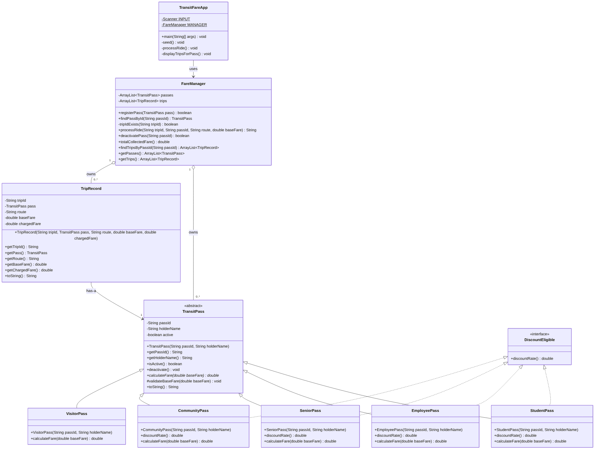

# Project 2: Smart Transit Fare & Pass Processing Engine

Console app that processes transit rides for different pass types. Each pass type has its own fare rule, and the manager charges the right fare through polymorphism without ever checking which type of pass it has.

## Run

```
cd project02
javac -d out src/*.java
java -cp out TransitFareApp
```

## Pass types

| Class | Discount | $10.00 base fare charges | Implements `DiscountEligible` |
|---|---|---|---|
| `StudentPass` | 50% | $5.00 | Yes |
| `EmployeePass` | 75% | $2.50 | Yes |
| `SeniorPass` (new) | 60% | $4.00 | Yes |
| `CommunityPass` (new) | 30% | $7.00 | Yes |
| `VisitorPass` | none | $10.00 | No |

`SeniorPass` and `CommunityPass` were written from scratch for the team extension. Both are seeded (`S400`, `C500`) and go through the same ride workflow as the others.

## OOP concepts and where they are

| Concept | Where |
|---|---|
| Inheritance (IS-A) | All five pass classes `extend TransitPass` and reuse its `passId`, `holderName`, and `active` state instead of redeclaring them. |
| Constructor chaining | Each pass constructor calls `super(passId, holderName)`, so the parent constructor validates and stores the shared fields. |
| Abstract class | `TransitPass` is `abstract` and declares `abstract double calculateFare(double)`. A plain `TransitPass` can't be created (see `tests/abstract-check.txt`). |
| Method overriding | Every pass class overrides `calculateFare` with `@Override` and calls the shared `validateBaseFare` first. |
| Interface | `DiscountEligible` with `discountRate()`. The four discounted passes implement it and use `discountRate()` in their fare formula. `VisitorPass` doesn't, since it has no discount. |
| Polymorphism / dynamic dispatch | `FareManager` stores `ArrayList<TransitPass>` and `processRide` just calls `pass.calculateFare(baseFare)`. No `instanceof` or type switch. Java runs the override for the object's real type. |
| HAS-A | `TripRecord` holds a `TransitPass` reference. |

## UML



Source: [docs/PROJ02-UML.mmd](docs/PROJ02-UML.mmd)

## Testing

See [TEST-EVIDENCE.md](TEST-EVIDENCE.md). Raw console output is in `tests/`.
